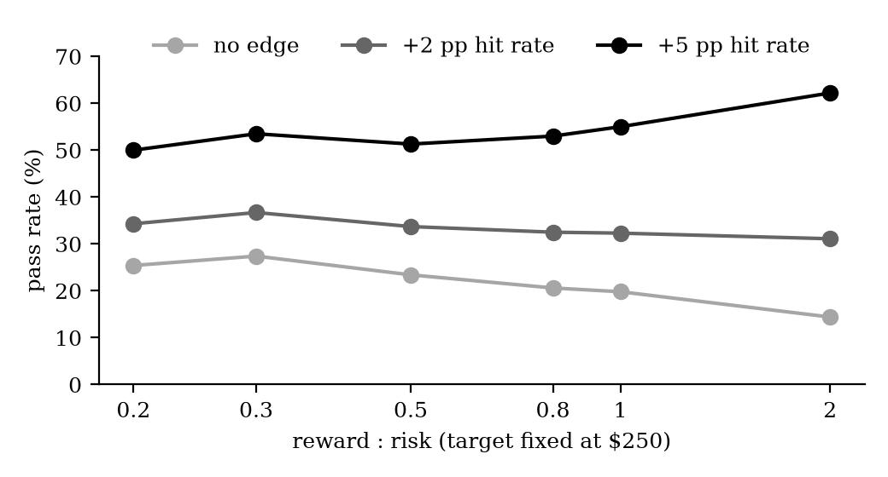

# Zero-Edge Pass Rates in Futures Prop-Firm Evaluations

**Paper:** [paper.pdf](paper.pdf)

How often does a trader with **no edge** pass a futures prop-firm evaluation, and does a low reward-to-risk (high win rate) help?

Monte-Carlo simulation of 20 standard 50K evaluation accounts from eight firms (Topstep, Apex, MyFundedFutures, FundedNext, Tradeify, Lucid, Take Profit Trader, FTMO), with intraday price paths, trailing drawdowns, locks, daily loss limits, consistency rules and costs.

## Key results

- **Ceiling:** for a fair random walk with a static drawdown, P(pass) = D / (D + T) = 2,000 / 5,000 = **40%** (gambler's ruin).
- **Real rules:** trailing drawdowns, daily limits and costs push this down to about **17–26%** for a 1:1 coin flip.
- **Low reward-to-risk** passes slightly more often without an edge when the target per trade is fixed (27% at 0.3:1 vs 20% at 1:1), because larger risk per trade means fewer trades to the goal.
- **With an edge** this disappears: +5 pp hit rate → 2:1 passes most often (62%).

## Contents

| Path | |
|---|---|
| `paper.pdf` / `paper.html` | the paper |
| `simulation/` | Monte-Carlo simulators (Python, NumPy) |
| `data/raster_rr_edge_kosten.csv` | simulated pass rates by reward-to-risk, edge and costs |
| `make_figures.py` | figures in the paper |

Run e.g. `python simulation/mc_rr.py` or `python simulation/mc_raster.py`. Code comments are in German.

Simulation only. Firm rules as of October 2026. Not investment advice.
